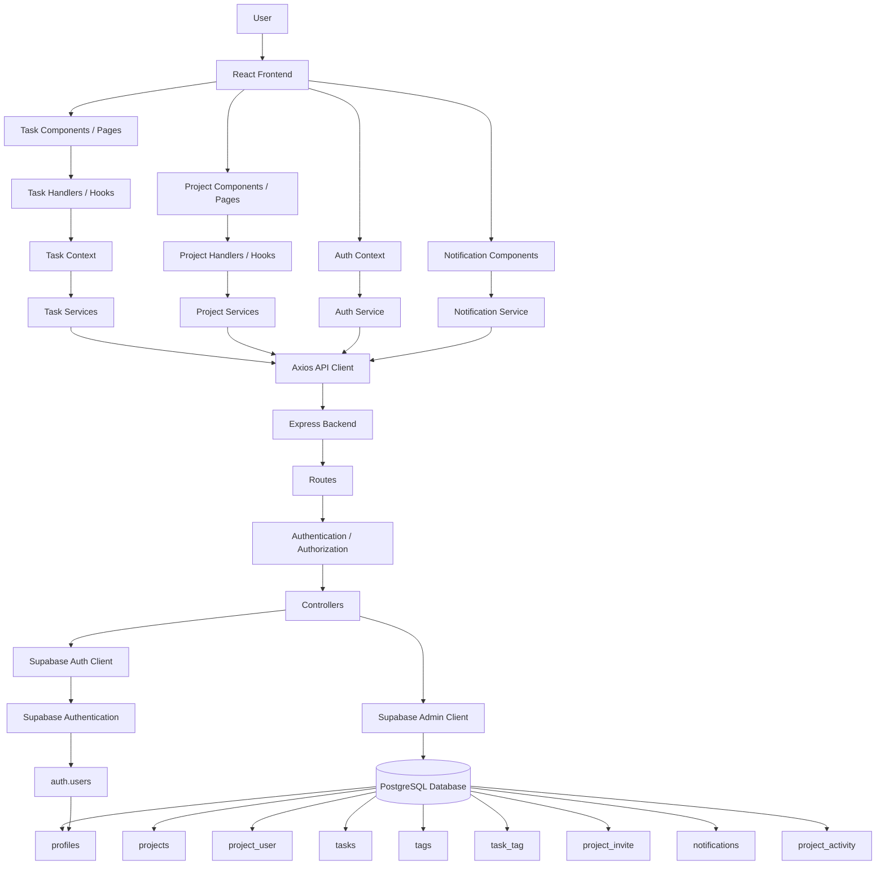
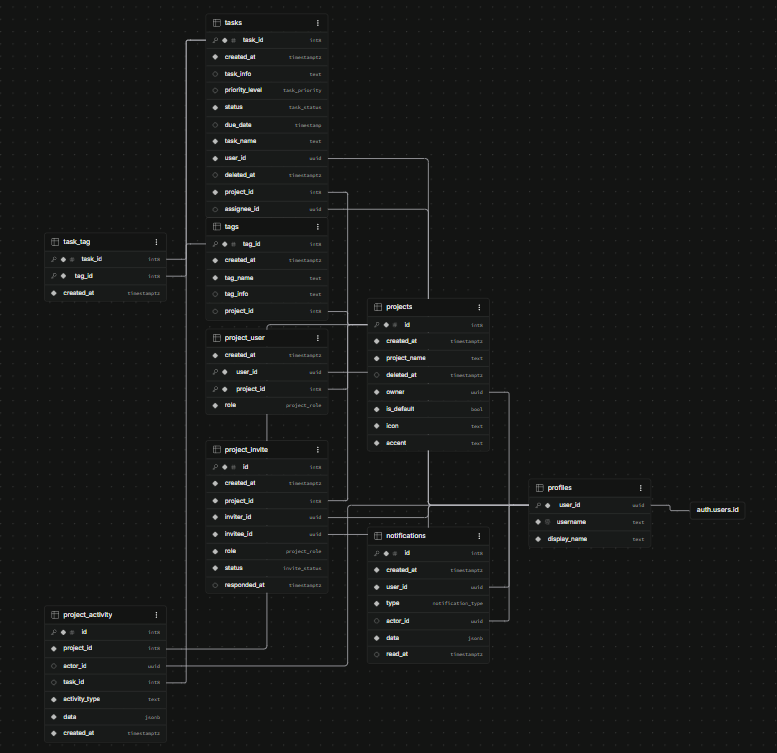

# Takda

Takda is a web-based task and project management application developed for **CMSC 128 – Software Engineering** at the University of the Philippines Visayas. It helps students organize schoolwork, deadlines, and everyday tasks through task management, filtering, sorting, calendar views, user accounts, and collaborative projects.

The application integrates the CRUD task-management functionality from Laboratory Activity 1 with the authentication and account-management functionality from Laboratory Activity 2, then extends the merged system with **User-Based Access Control (UBAC)** and collaborative project features for Laboratory Activity 3.

Takda uses a **React + Vite** frontend, a **Node.js + Express** backend, and **Supabase PostgreSQL + Supabase Authentication** for persistent application data and user sessions.

---

## Features

### Task Management
- Create tasks with a title, description, due date and time, priority, status, and tags
- View and edit existing tasks
- Soft-delete tasks with confirmation and restore recently deleted tasks
- Mark tasks as completed and update task status
- Search tasks
- Filter tasks by category, status, priority, and tag
- Sort tasks by title, priority, due date, and date added
- Paginate task lists
- View tasks through list and calendar interfaces, with a board view for collaborative project workspaces
- Keep completed tasks visible with visual distinction

### Authentication & Account Management
- Register a user account with form validation and password confirmation
- Log in using either a username or email address
- Show or hide passwords through password visibility controls
- Maintain authenticated sessions across page refreshes
- Refresh expired access tokens using stored refresh tokens
- Protect application routes from unauthenticated access
- Log out with confirmation
- View account information through the Profile page
- Update display name and username
- Change email address with confirmation
- Change password
- Recover forgotten passwords through email
- Access the Privacy Policy

### Personal & Collaborative Projects
- Maintain a default personal project for each user
- Create additional collaborative projects
- View only projects in which the authenticated user is a member
- Invite users by username or email
- Accept or decline project invitations
- Assign **Owner**, **Editor**, and **Viewer** project roles
- Change member roles and remove members
- Leave a collaborative project
- Soft-delete and restore owned collaborative projects
- View project overview, list, board, calendar, members, and activity views
- Track recent project activity

### Notifications
- View task-related notifications and reminders
- Receive project invitation notifications
- Receive notifications for relevant project activity, including project deletion and restoration
- View the unread notification count
- Mark individual or all notifications as read
- Dismiss notifications
- Accept or decline pending project invitations through notification actions


### Appearance & Navigation
- Switch between light and dark themes
- Persist the selected theme
- Use responsive layouts across desktop, tablet, and mobile devices
- Navigate through a desktop sidebar or mobile bottom navigation

---

## Activity 3 Integration

### Merge Strategy
Activity 3 uses the same repository as Activities 1 and 2. The integration branch is:

```text
act3-ubac
```

The Activity 1 CRUD implementation and Activity 2 authentication and account-management implementation were brought together through Git branching and merge/pull-request workflows instead of rebuilding the application.

Subsequent Activity 3 collaboration work is developed on identifiable feature branches such as:

```text
feature/project-collaboration
```

and is intended to be merged back into `act3-ubac` through a pull request so individual contributions remain visible in Git history.

### Conflict Resolution Approach
Where the CRUD and authentication features affected the same application flow, the integrated implementation reconciled their requirements by:

1. preserving the Activity 1 task CRUD behavior;
2. preserving the Activity 2 authentication and session behavior;
3. using the authenticated backend identity (`req.user.id`) for protected operations;
4. associating tasks with users and projects;
5. enforcing authorization checks on the backend rather than relying only on frontend visibility; and
6. extending the integrated data model with collaborative projects, membership roles, invitations, activity, and notifications.

---

## Tech Stack

<p align="center">
  
  
  
  
  
</p>

<p align="center">
  
  
  
  
</p>

<p align="center">
  
  
  
  
</p>

### Technologies

| Layer | Technology | Purpose |
| --- | --- | --- |
| **Frontend** | React | Builds the user interface using reusable components |
| | Vite | Provides the development server and build tools |
| | Tailwind CSS | Provides utility classes for styling |
| | React Router | Handles client-side routing and navigation |
| | Axios | Sends HTTP requests to the backend API |
| | Lucide React | Provides interface icons |
| | Sonner | Provides toast notifications and user feedback |
| | Motion | Provides interface transitions and animations |
| **Backend** | Node.js | Runs the server-side JavaScript application |
| | Express.js | Handles API routes and HTTP requests |
| | `@supabase/supabase-js` | Provides the JavaScript client for communicating with Supabase |
| | Helmet | Adds security-related HTTP headers |
| | express-rate-limit | Limits repeated requests to protect API endpoints |
| | CORS | Allows controlled communication between the frontend and backend |
| | dotenv | Loads environment variables from `.env` |
| **Database & Authentication** | Supabase / PostgreSQL | Stores persistent application data |
| | Supabase Authentication | Manages user accounts, authentication, and sessions |
| **Testing** | Vitest | Runs automated frontend and backend tests |
| | React Testing Library | Tests React components, hooks, and user interactions |

---

## Project Architecture
Takda follows a client-server architecture. The React frontend communicates with the Express backend through a REST API, while the backend uses Supabase for PostgreSQL data storage and user authentication. The frontend is organized by feature, while authentication and authorization are enforced by the backend before protected resources are accessed.



### Data Flow

**Task CRUD:**  
`User → React Components → Task Handlers / Hooks → Task Context → Task Service → Axios → Express Routes → Access Checks → Task Controller → Supabase → PostgreSQL`

**Authentication:**  
`User → Login / Signup → Auth Context → Auth Service → Axios → Express Auth Routes → Auth Controller → Supabase Authentication → Session`

**Collaborative Projects:**  
`User → Project Components → Project Handlers / Hooks → Project Service → Axios → Express Project Routes → Project Role Check → Project / Member / Invite Controller → Supabase → PostgreSQL`

**Notifications:**  
`User → Notification Components → Notification Service → Axios → Express Notification Routes → Authentication → Notification Controller → Supabase → PostgreSQL`

### Supabase Clients

The backend uses two Supabase clients depending on the type of operation:

- **Anon-key client** (`config/supabaseClient.js`) — Uses `SUPABASE_ANON_KEY`, with `SUPABASE_KEY` supported as a fallback. It handles user-scoped Supabase Authentication operations such as login, session refresh, logout, password recovery, and email or password changes.

- **Service-role client** (`config/supabaseAdmin.js`) — Handles authorized server-side database operations involving tasks, projects, memberships, invitations, notifications, tags, profiles, and related records. Because the service-role key has elevated privileges, it is kept exclusively on the backend.

---

## Project Structure

```text
cmsc128-Lab1_CRUD_Sumergido-Tarre/
│
├── backend/
│   ├── config/          # Supabase clients
│   ├── controllers/     # API request handlers
│   ├── middleware/      # Authentication and rate limiting
│   ├── routes/          # Express API routes
│   ├── tests/           # Backend tests
│   ├── utils/           # Validation, access control, notifications
│   └── app.js
│
├── frontend/
│   ├── src/
│   │   ├── features/
│   │   │   ├── auth/
│   │   │   ├── calendar/
│   │   │   ├── notifications/
│   │   │   ├── profile/
│   │   │   ├── projects/
│   │   │   └── tasks/
│   │   ├── shared/
│   │   ├── layouts/
│   │   ├── pages/
│   │   └── routes/
│   ├── tests/
│   └── vite.config.js
│
├── README.md
└── package.json
```

---

## Installation

### Preliminary

Create a `.env` file in the `/backend` directory:

```env
PORT=5000
FRONTEND_URL=http://localhost:5173

SUPABASE_URL=your_supabase_url
SUPABASE_ANON_KEY=your_supabase_anon_key
SUPABASE_SERVICE_ROLE_KEY=your_supabase_service_role_key
```

- `SUPABASE_URL` — URL of the configured Supabase project.
- `SUPABASE_ANON_KEY` — preferred environment variable for the Supabase anon/public key used for user-scoped authentication operations. The current backend also accepts `SUPABASE_KEY` as a fallback.
- `SUPABASE_SERVICE_ROLE_KEY` — used only by the backend for authorized server-side database operations that require elevated access. **Never expose this key to the frontend or commit it to version control.**
- `FRONTEND_URL` — frontend origin used for CORS and authentication redirects such as password reset and email verification.

Do not commit the actual `.env` file or expose your credentials.

#### Supabase Dashboard Configuration

Configure the following settings in the Supabase Dashboard:

- **Authentication → URL Configuration → Redirect URLs** — add `<FRONTEND_URL>/reset-password` and `<FRONTEND_URL>/verify-email`
- **Authentication → Providers → Email → Secure email change** — configure the required confirmation behavior for email changes.


### 1. Install Dependencies
Install the backend dependencies:

```bash
cd backend
npm install
```

Install the frontend dependencies:

```bash
cd ../frontend
npm install
```

### 2. Start the Backend Server
From the `/backend` directory:

```bash
node app.js
```

or:

```bash
npm start
```

The backend runs at `http://localhost:5000`.

> The backend does not use `nodemon`, so restart the server manually after code or `.env` changes.

### 3. Start the Frontend
From the `/frontend` directory:

```bash
npm run dev
```

The frontend runs at `http://localhost:5173`.

Open the frontend URL in a browser to use Takda.

---

## Testing
From the project root, run all automated tests:

```bash
npm test
```

Run the backend and frontend test suites individually:

```bash
npm run test:backend
npm run test:frontend
```

Check the frontend for linting issues:

```bash
npm run lint
```

Verify the frontend production build:

```bash
npm run build
```

The automated tests cover authentication, task CRUD, project collaboration, membership and role access control, invitations, notifications, services, hooks, handlers, validation, utilities, and shared frontend functionality.

---

## API Endpoints

All protected endpoints require a valid authenticated session. Project-specific operations may additionally require **Member**, **Editor**, or **Owner** access.

### Auth (`/api/auth`)

| Method | Endpoint | Auth | Description |
| --- | --- | --- | --- |
| `POST` | `/api/auth/signup` | Not required | Register a new account |
| `POST` | `/api/auth/login` | Not required | Log in with username or email |
| `POST` | `/api/auth/logout` | Session token | End the current session |
| `POST` | `/api/auth/refresh` | Refresh token | Refresh an expired access token |
| `GET` | `/api/auth/me` | Required | Get the authenticated user and profile |
| `POST` | `/api/auth/forgot-password` | Not required | Send a password-reset email |
| `POST` | `/api/auth/reset-password` | Recovery tokens | Reset the user's password |

### Tasks (`/api/tasks`)

| Method | Endpoint | Auth | Description |
| --- | --- | --- | --- |
| `GET` | `/api/tasks` | Required | Retrieve accessible tasks |
| `POST` | `/api/tasks` | Required | Create a task |
| `PUT` | `/api/tasks/:task_id` | Required | Update an authorized task |
| `DELETE` | `/api/tasks/:task_id` | Required | Soft-delete an authorized task |
| `PATCH` | `/api/tasks/:task_id/restore` | Required | Restore a soft-deleted task |

### Tags (`/api/tags`)

| Method | Endpoint | Auth | Description |
| --- | --- | --- | --- |
| `GET` | `/api/tags` | Required | Retrieve available task tags |

### Users (`/api/users`)

| Method | Endpoint | Auth | Description |
| --- | --- | --- | --- |
| `PATCH` | `/api/users/me` | Required | Update profile information |
| `PATCH` | `/api/users/me/email` | Required | Change the user's email |
| `PATCH` | `/api/users/me/password` | Required | Change the user's password |

### Projects (`/api/projects`)

| Method | Endpoint | Auth | Description |
| --- | --- | --- | --- |
| `GET` | `/api/projects` | Required | Retrieve accessible active projects |
| `GET` | `/api/projects?deleted=true` | Owner | Retrieve owned deleted projects |
| `POST` | `/api/projects` | Required | Create a collaborative project |
| `PUT` | `/api/projects/:project_id` | Owner | Update project information |
| `DELETE` | `/api/projects/:project_id` | Owner | Soft-delete a project |
| `PATCH` | `/api/projects/:project_id/restore` | Owner | Restore a deleted project |
| `GET` | `/api/projects/:project_id/activities` | Member | Retrieve recent project activity |
| `GET` | `/api/projects/:project_id/members` | Member | Retrieve project members |
| `PATCH` | `/api/projects/:project_id/members/:user_id` | Owner | Change a member's role |
| `DELETE` | `/api/projects/:project_id/members/:user_id` | Owner | Remove a project member |
| `POST` | `/api/projects/:project_id/leave` | Member | Leave a collaborative project |

Project roles follow the hierarchy:

`viewer < editor < owner`

### Project Invitations

| Method | Endpoint | Auth | Description |
| --- | --- | --- | --- |
| `GET` | `/api/projects/:project_id/invites` | Owner | Retrieve pending project invitations |
| `POST` | `/api/projects/:project_id/invites` | Owner | Invite a user by username or email |
| `DELETE` | `/api/projects/:project_id/invites/:invite_id` | Owner | Cancel a pending invitation |
| `GET` | `/api/invites` | Required | Retrieve the user's pending invitations |
| `POST` | `/api/invites/:invite_id/accept` | Invitee | Accept an invitation |
| `POST` | `/api/invites/:invite_id/decline` | Invitee | Decline an invitation |

### Notifications (`/api/notifications`)

| Method | Endpoint | Auth | Description |
| --- | --- | --- | --- |
| `GET` | `/api/notifications` | Required | Retrieve the user's notifications |
| `PATCH` | `/api/notifications/:notification_id/read` | Required | Mark one notification as read |
| `PATCH` | `/api/notifications/read-all` | Required | Mark all notifications as read |
| `DELETE` | `/api/notifications/:notification_id` | Required | Dismiss a notification |

---

## Database Schema / ERD
Takda uses Supabase PostgreSQL for persistent application data and Supabase Authentication for account identities. The main application tables are:

- **`profiles`** — stores usernames and display names
- **`projects`** — stores personal/default and collaborative projects
- **`project_user`** — associates users with projects and stores membership roles
- **`tasks`** — stores task information and associates tasks with users and projects
- **`tags`** — stores global or project-scoped task tags
- **`task_tag`** — manages the many-to-many relationship between tasks and tags
- **`project_invite`** — stores collaborative project invitations
- **`project_activity`** — stores recent project activity
- **`notifications`** — stores user notifications

Supabase Authentication stores account identities separately in `auth.users`, while application-specific profile information is stored in `profiles`.



### Main Task Fields

| Field | Description |
| --- | --- |
| `task_id` | Unique task identifier |
| `task_name` | Task title |
| `task_info` | Task description |
| `priority_level` | Task priority |
| `user_id` | User associated with the task |
| `project_id` | Project containing the task |
| `assignee_id` | Optional assigned project member |
| `status` | Current task status |
| `due_date` | Task due date and time |
| `created_at` | Task creation timestamp |
| `deleted_at` | Soft-delete timestamp; `null` when active |

---
## Authentication
Takda uses **Supabase Authentication** together with backend authorization to manage user accounts, sessions, and protected resources.

### Registration
Users can create an account using a display name, username, email address, and password. Registration validates required fields, email format, password confirmation, password strength, and duplicate account information.

Passwords must contain at least 8 characters, including an uppercase letter, lowercase letter, number, and special character. Passwords are handled by Supabase Authentication and are not stored as plaintext in Takda's application database.

### Login & Session Persistence
Users can log in using either their username or email address. Successful authentication creates a Supabase session and redirects the user to **My Tasks**.

The frontend stores the access and refresh tokens and restores the authenticated user state across page refreshes. Expired access tokens can be refreshed automatically; invalid session data is cleared when authentication can no longer be restored.

### Protected Routes
Authenticated application pages are protected through `ProtectedRoute`. Users without a valid authenticated session are redirected to the login page.

### Account Management & Recovery
Authenticated users can update their display name, username, email address, and password. Email and password changes are processed through Supabase Authentication and follow the application's validation requirements.

Users who forget their password can request a recovery email. The recovery link redirects to Takda's password-reset flow, where temporary Supabase recovery tokens are used to establish a recovery session and securely update the password.

### Project Access Control
Collaborative project access is represented through the `project_user` table. Each membership has one of three roles:

- **Owner** — full project control
- **Editor** — can manage project work
- **Viewer** — read-only access

The backend verifies project membership and role before allowing protected project operations. 

### IDOR Prevention
Takda reduces Insecure Direct Object Reference (IDOR) risk by enforcing authorization on the backend:

- Non-members cannot retrieve project data simply by changing a project ID.
- Inaccessible project resources return `404 Project not found`.
- Users with insufficient project roles receive `403 Insufficient permissions`.
- Task update, delete, and restore operations validate access to the task's project before modification.
- Invitation responses are scoped to the intended authenticated user.

Returning `404` for inaccessible projects also helps reduce resource enumeration.

### Notification Access
Notifications are tied to the authenticated user and are retrieved and modified using the user's verified backend identity. Users can view, mark as read, or dismiss only their own notifications.

---
## Expanded Features

### Lab 1 - Task Organization
Tasks can be searched, filtered by category, status, priority, and tag, and sorted by title, priority, due date, or date added. The Calendar View organizes tasks by due date, while recently deleted tasks can be restored.

### Lab 2 - User Accounts and Authentication
Takda extends the original task-management application with persistent user accounts through Supabase Authentication. Users can register, log in using either their username or email address, maintain authenticated sessions, manage their profile and account credentials, log out, and recover forgotten passwords through email.

### Lab 3 - UBAC and Collaborative Projects
Takda extends the merged Activity 1 and Activity 2 system with **User-Based Access Control (UBAC)** and the collaborative-list functionality required for Activity 3. The collaborative-list requirement is implemented through personal/default projects and collaborative projects, allowing users to manage their own tasks while also accessing projects to which they have been added.

Users can create collaborative projects, invite other registered users by username or email, and access only the collaborative projects in which they are members. Project membership is stored separately from user and task data, while **Owner**, **Editor**, and **Viewer** roles provide additional control over what members can do within a project.

Ownership and membership checks are enforced on the backend rather than relying only on frontend visibility. Task and project operations use the authenticated user's identity and project membership to prevent unauthorized access and IDOR attempts, while the existing Supabase Authentication and session flow from Activity 2 is reused for account authentication.

---
## Data Persistence
Takda stores persistent application data in Supabase PostgreSQL, including tasks, projects, memberships, invitations, notifications, and profile information. User accounts and sessions are managed through Supabase Authentication, allowing application data and authenticated state to persist across normal page refreshes and backend restarts.

---
## HCI Considerations
Takda applies HCI principles through:

- Clear labels for task fields, account forms, and actions
- Consistent navigation and layout across application pages
- Visual distinction between task statuses and priorities
- Toast notifications and clear feedback for successful or failed actions
- Confirmation dialogs before destructive or session-ending actions
- Search, filtering, sorting, pagination, and calendar views for efficient task navigation
- Password visibility controls and understandable form-validation messages
- Loading and disabled states during asynchronous actions
- Responsive layouts across desktop, tablet, and mobile devices
- Persistent light and dark theme preferences

---
## Contributors
- **Gabrielle Sumergido**
- **Ma. Christie Jude Tarre**

---
## Course Information
**CMSC 128 – Software Engineering**

**University of the Philippines Visayas**

**1st Semester, AY 2026–2027**