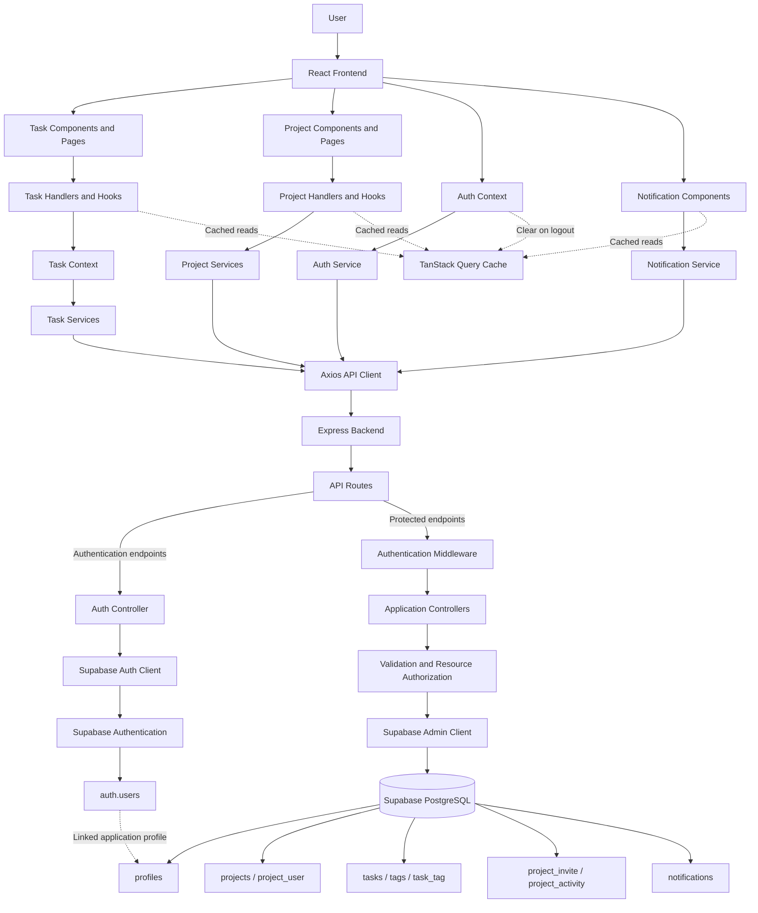

# Takda

Takda is a web-based task and project management application developed for **CMSC 128 – Software Engineering** at the University of the Philippines Visayas. It helps students organize academic responsibilities, deadlines, and everyday tasks through personal task lists, calendar views, and collaborative projects.

The application evolved across four laboratory activities. Activity 1 established task CRUD operations, and Activity 2 added authentication and account management. Activity 3 integrated these features through **User-Based Access Control (UBAC)** and collaborative projects. Activity 4 builds on this foundation through code refactoring, backend optimization, UX/UI improvements, and deployment preparation while retaining existing functionality.

Takda uses **React + Vite** for the frontend, **Node.js + Express** for the backend, and **Supabase PostgreSQL + Supabase Authentication** for data storage and user sessions. Automated tests, Docker containers, and GitHub Actions support validation, packaging, and deployment workflows.

---

## Features

Takda combines the core and expanded features from Activities 1–3 with additional productivity tools and interface refinements.

### Expanded Features from Previous Activities

The following expanded features from Activities 1–3 are implemented in Takda:

| Activity | Implemented Expanded Features | Feature Category |
| --- | --- | --- |
| Activity 1 | Task search, filtering, sorting, calendar views, and restoration of deleted tasks | Task Management |
| Activity 2 | Profile management and email-based password recovery | Authentication & Account Management |
| Activity 3 | Collaborative projects, invitations, and project membership with Owner, Editor, and Viewer roles | Personal & Collaborative Projects |

The categories below describe these features together with the core functionality and additional productivity tools.

### Task Management
- Create tasks with a title, description, optional due date and time, priority, status, and tags
- View and edit existing tasks
- Soft-delete tasks with confirmation and restore recently deleted tasks
- Mark tasks as completed and update task status
- Search tasks by keyword
- Filter tasks by category, status, priority, and tag
- Sort tasks by title, priority, due date, and date added
- Paginate task lists
- View tasks through list and calendar interfaces, with a board view for collaborative project workspaces
- Keep completed tasks visible with visual distinction
- Assign tasks to members of collaborative projects

### Authentication & Account Management
- Register a user account with form validation and password confirmation
- Log in using either a username or email address
- Show or hide passwords through password visibility controls
- Maintain authenticated sessions across page refreshes
- Refresh expired access tokens using stored refresh tokens
- Protect application routes from unauthenticated access
- Log out with confirmation
- View account information through the Profile page
- Update display name and username
- Change email address with confirmation
- Change password
- Recover forgotten passwords through email
- Access the Privacy Policy

### Personal & Collaborative Projects
- Maintain a default personal project for each user
- Create additional collaborative projects
- View only projects in which the authenticated user is a member
- Invite users by username or email
- Accept or decline project invitations
- Assign **Owner**, **Editor**, and **Viewer** project roles
- Change member roles and remove members
- Leave a collaborative project
- Soft-delete and restore owned collaborative projects
- View project overview, list, board, calendar, members, and activity views
- Track recent project activity
- Manage project-specific tags
- Enforce project membership and role-based access restrictions

### Notifications
- View task-related notifications and reminders
- Receive project invitation notifications
- Receive notifications for relevant project activity, including project deletion and restoration
- View the unread notification count
- Mark individual or all notifications as read
- Dismiss notifications
- Accept or decline pending project invitations through notification actions

### Focus Mode & Productivity
- Start adjustable focus and break timers
- Associate focus sessions with an optional task
- Enable an optional session lock during focus periods
- Track completed focus time through a seven-day activity chart
- Save and select Spotify playlists for optional playback during focus sessions
- Display the Focus Mode timer and optional Spotify player through Picture-in-Picture
- Use the interactive Task Companion for visual feedback during task activities
- Retain Task Companion preferences and positioning across sessions

### Appearance & Navigation
- Switch between light and dark themes
- Persist the selected theme
- Use responsive layouts across desktop, tablet, and mobile devices
- Navigate through a desktop sidebar or mobile bottom navigation
- Receive visual feedback through notifications, confirmation dialogs, and status indicators
- Use consistent form controls, dropdown menus, and validation messages

---

## Tech Stack

<p align="center">
  
  
  
  
  
</p>

<p align="center">
  
  
  
  
</p>

<p align="center">
  
  
  
  
</p>

<p align="center">
  
  
  
  
</p>

### Technologies

| Layer | Technology | Purpose |
| --- | --- | --- |
| **Frontend** | React | Builds the user interface using reusable components |
| | Vite | Provides development and production build tools |
| | Tailwind CSS | Provides utility classes for styling |
| | React Router | Handles client-side routing and navigation |
| | Axios | Sends HTTP requests to the backend API |
| | Lucide React | Provides interface icons |
| | Sonner | Provides toast notifications and user feedback |
| | Motion | Provides interface transitions and animations |
| | TanStack Query | Caches API results, reduces duplicate requests, and updates related data after mutations |
| **Backend** | Node.js | Runs the server-side JavaScript application |
| | Express.js | Handles REST API routes and HTTP requests |
| | `@supabase/supabase-js` | Connects the backend to Supabase services |
| | Helmet | Adds security-related HTTP headers |
| | express-rate-limit | Limits repeated requests to sensitive endpoints |
| | CORS | Restricts access to the configured frontend origin |
| | dotenv | Loads environment variables from `.env` |
| **Database & Authentication** | Supabase PostgreSQL | Stores persistent application data |
| | Supabase Authentication | Manages user accounts, authentication, and sessions |
| **Testing & Code Quality** | Vitest | Runs automated frontend and backend tests |
| | React Testing Library | Tests React components and user interactions |
| | ESLint | Checks frontend code quality and consistency |
| **Containerization** | Docker | Packages the frontend and backend into separate container images |
| | Docker Compose | Defines and manages the application services |
| | Nginx | Serves the production frontend build and proxies API requests in the frontend container |
| **Deployment Configuration** | Caddy | Provides HTTPS and reverse proxy support in the Docker production configuration |
| **CI/CD** | GitHub Actions | Automates testing, linting, build validation, and configured deployment workflows |
| | Git | Tracks source code changes and supports branch-based collaboration |

## Development and Refactoring

Takda uses the same public GitHub repository across all four laboratory activities. Activity 3 integrated the task CRUD operations from Activity 1 with the authentication system from Activity 2 through the `act3-ubac` branch.

The integration retained existing task and account features while introducing personal and collaborative projects. Tasks reference users and projects, and separate records manage memberships, invitations, activity, and notifications. Protected operations use the authenticated backend identity (`req.user.id`) and enforce ownership or project-role checks.

### Activity 4 Improvements

Activity 4 builds on the integrated application through code refactoring, data-access improvements, and UX/UI refinement.

| Area | Changes | Reason |
| --- | --- | --- |
| Code Organization | Organize frontend code by feature and separate reusable components, hooks, services, and utilities | Make responsibilities clearer and reduce duplicated logic |
| Backend Structure | Separate API routes, controllers, middleware, and shared utilities | Keep request handling, validation, and access checks easier to maintain |
| Data Retrieval | Use dedicated resource endpoints, including `GET /api/projects/:project_id` | Retrieve the required project instead of downloading and searching the full project list |
| Request Reuse | Use TanStack Query for shared frontend reads | Reduce duplicate API requests during navigation |
| Data Updates | Update affected cache entries or invalidate related query keys after mutations | Keep displayed data consistent with saved changes |
| Authorization | Retain backend identity, membership, and role checks | Preserve UBAC and prevent unauthorized resource access after refactoring |
| UX/UI | Refine navigation, forms, spacing, responsive layouts, validation, and loading/success/error states | Apply CMSC 134 principles of consistency, feedback, error prevention, and readable presentation |

### Query and Cache Behavior

Takda uses **TanStack Query** to cache projects, project details, tasks, tags, members, invitations, activity, and notifications. Pages reuse cached results during navigation to reduce duplicate API requests.

- Cached data remains fresh for 30 seconds. Inactive queries are garbage-collected after five minutes.
- Returning focus to the browser window alone does not trigger a refetch.
- Successful mutations update affected cache entries or invalidate related queries.
- Login and logout clear the query cache to prevent reuse across accounts.
- API responses use `Cache-Control: private, no-store` to prevent storage in shared HTTP caches.

Workspace and settings pages retrieve individual projects through `GET /api/projects/:project_id` instead of downloading and searching the complete project list.

Supabase PostgreSQL remains the source of persistent data. Existing database indexes support project membership lookups, task-assignee queries, notification retrieval, and recent project activity. Backend authentication and authorization continue to control access to protected resources.

#### Recommended Database Indexes

The following indexes are suggested for common application queries. Some query patterns are already supported by existing indexes, but this complete set has not been applied to the current database.

Review existing index definitions before running these statements to avoid unnecessary overlap.

```sql
CREATE INDEX IF NOT EXISTS idx_project_user_user_project
    ON project_user (user_id, project_id);

CREATE INDEX IF NOT EXISTS idx_tasks_project_deleted_created
    ON tasks (project_id, deleted_at, created_at DESC);

CREATE INDEX IF NOT EXISTS idx_tasks_project_assignee_deleted
    ON tasks (project_id, assignee_id, deleted_at);

CREATE INDEX IF NOT EXISTS idx_notifications_user_read_created
    ON notifications (user_id, read_at, created_at DESC);

CREATE INDEX IF NOT EXISTS idx_project_activity_project_created
    ON project_activity (project_id, created_at DESC);
```

Apply selected indexes through the Supabase SQL editor or a database migration after reviewing the relevant queries. `IF NOT EXISTS` checks the index name; it does not detect equivalent indexes with different names.

### Branches and Integration

Activity 4 work is integrated through `act4-refactor`. Each partner contributes through identifiable feature branches and pull requests that document individual changes.

After integration and testing, `act4-refactor` will be merged into `main` so the main branch contains the final deployed version.

---

## Project Architecture

Takda follows a client-server architecture. The React frontend communicates with the Express backend through a REST API. Frontend features use components, hooks, contexts, and services, while TanStack Query provides a shared cache for application reads.

The backend handles request validation, authentication, and resource authorization before protected data is accessed. Supabase PostgreSQL stores application records, while Supabase Authentication manages account identities and sessions.



Solid arrows show the main request and service paths. Dashed arrows show cache interactions and the link between authentication identities and application profiles.

Authentication requirements depend on the endpoint. Registration and login are publicly accessible. Protected application endpoints verify the authenticated user, while project operations also enforce membership and role permissions.

### Supabase Clients

The backend uses two Supabase clients:

- **Auth client** (`backend/config/supabaseClient.js`) — Uses `SUPABASE_ANON_KEY`, with `SUPABASE_KEY` supported as a fallback. It handles authentication operations such as login, session refresh, logout, password recovery, and email or password changes.
- **Admin client** (`backend/config/supabaseAdmin.js`) — Performs server-side database operations after the required application authorization checks. Its service-role key remains exclusively on the backend.

---

## Project Structure

```text
cmsc128-Lab1_CRUD_Sumergido-Tarre/
│
├── backend/
│   ├── config/          # Supabase clients
│   ├── controllers/     # API request handlers
│   ├── middleware/      # Authentication and rate limiting
│   ├── routes/          # Express API routes
│   ├── tests/           # Backend tests
│   ├── utils/           # Validation, access control, notifications
│   └── app.js
│
├── frontend/
│   ├── src/
│   │   ├── features/
│   │   │   ├── auth/
│   │   │   ├── calendar/
│   │   │   ├── notifications/
│   │   │   ├── profile/
│   │   │   ├── projects/
│   │   │   └── tasks/
│   │   ├── shared/
│   │   ├── layouts/
│   │   ├── pages/
│   │   └── routes/
│   ├── tests/
│   └── vite.config.js
│
├── README.md
└── package.json
```

---

## Docker and CI

Takda supports Docker Compose for local containerization and GitHub Actions for automated testing and build validation.

See the [Docker and CI Guide](docs/docker-ci.md) for setup instructions, configuration, troubleshooting, and CI details.

## Deployment

---

## Installation

### Preliminary

Create a `.env` file in the `/backend` directory:

```env
PORT=5000
FRONTEND_URL=http://localhost:5173

SUPABASE_URL=your_supabase_url
SUPABASE_ANON_KEY=your_supabase_anon_key
SUPABASE_SERVICE_ROLE_KEY=your_supabase_service_role_key
```

- `SUPABASE_URL` — URL of the configured Supabase project.
- `SUPABASE_ANON_KEY` — preferred environment variable for the Supabase anon/public key used for user-scoped authentication operations. The current backend also accepts `SUPABASE_KEY` as a fallback.
- `SUPABASE_SERVICE_ROLE_KEY` — used only by the backend for authorized server-side database operations that require elevated access. **Never expose this key to the frontend or commit it to version control.**
- `FRONTEND_URL` — frontend origin used for CORS and authentication redirects such as password reset and email verification.

Do not commit the actual `.env` file or expose your credentials.

#### Supabase Dashboard Configuration

Configure the following settings in the Supabase Dashboard:

- **Authentication → URL Configuration → Redirect URLs** — add `<FRONTEND_URL>/reset-password` and `<FRONTEND_URL>/verify-email`
- **Authentication → Providers → Email → Secure email change** — configure the required confirmation behavior for email changes.


### 1. Install Dependencies
Install the backend dependencies:

```bash
cd backend
npm install
```

Install the frontend dependencies:

```bash
cd ../frontend
npm install
```

### 2. Start the Backend Server
From the `/backend` directory:

```bash
node app.js
```

or:

```bash
npm start
```

The backend runs at `http://localhost:5000`.

> The backend does not use `nodemon`, so restart the server manually after code or `.env` changes.

### 3. Start the Frontend
From the `/frontend` directory:

```bash
npm run dev
```

The frontend runs at `http://localhost:5173`.

Open the frontend URL in a browser to use Takda.

---

## Testing
From the project root, run all automated tests:

```bash
npm test
```

Run the backend and frontend test suites individually:

```bash
npm run test:backend
npm run test:frontend
```

Check the frontend for linting issues:

```bash
npm run lint
```

Verify the frontend production build:

```bash
npm run build
```

The automated tests use Vitest. Backend tests cover controllers and authorization utilities; frontend tests cover authentication, protected routing, services, hooks, components, profile interactions, task and project workflows, notifications, and validation utilities. API and Supabase calls are mocked, so valid Supabase credentials are not required to run the test suites.

---

## API Endpoints

All protected endpoints require a valid authenticated session. Project-specific operations may additionally require **Member**, **Editor**, or **Owner** access.

### Auth (`/api/auth`)

| Method | Endpoint | Auth | Description |
| --- | --- | --- | --- |
| `POST` | `/api/auth/signup` | Not required | Register a new account |
| `POST` | `/api/auth/login` | Not required | Log in with username or email |
| `POST` | `/api/auth/logout` | Session token | End the current session |
| `POST` | `/api/auth/refresh` | Refresh token | Refresh an expired access token |
| `GET` | `/api/auth/me` | Required | Get the authenticated user and profile |
| `POST` | `/api/auth/forgot-password` | Not required | Send a password-reset email |
| `POST` | `/api/auth/reset-password` | Recovery tokens | Reset the user's password |

### Tasks (`/api/tasks`)

| Method | Endpoint | Auth | Description |
| --- | --- | --- | --- |
| `GET` | `/api/tasks` | Required | Retrieve accessible tasks |
| `POST` | `/api/tasks` | Required | Create a task |
| `PUT` | `/api/tasks/:task_id` | Required | Update an authorized task |
| `DELETE` | `/api/tasks/:task_id` | Required | Soft-delete an authorized task |
| `PATCH` | `/api/tasks/:task_id/restore` | Required | Restore a soft-deleted task |

### Tags (`/api/tags`)

| Method | Endpoint | Auth | Description |
| --- | --- | --- | --- |
| `GET` | `/api/tags` | Required | Retrieve available task tags |

### Users (`/api/users`)

| Method | Endpoint | Auth | Description |
| --- | --- | --- | --- |
| `PATCH` | `/api/users/me` | Required | Update profile information |
| `PATCH` | `/api/users/me/email` | Required | Change the user's email |
| `PATCH` | `/api/users/me/password` | Required | Change the user's password |

### Projects (`/api/projects`)

| Method | Endpoint | Auth | Description |
| --- | --- | --- | --- |
| `GET` | `/api/projects` | Required | Retrieve accessible active projects |
| `GET` | `/api/projects?deleted=true` | Owner | Retrieve owned deleted projects |
| `POST` | `/api/projects` | Required | Create a collaborative project |
| `PUT` | `/api/projects/:project_id` | Owner | Update project information |
| `DELETE` | `/api/projects/:project_id` | Owner | Soft-delete a project |
| `PATCH` | `/api/projects/:project_id/restore` | Owner | Restore a deleted project |
| `GET` | `/api/projects/:project_id/activities` | Member | Retrieve recent project activity |
| `GET` | `/api/projects/:project_id/members` | Member | Retrieve project members |
| `PATCH` | `/api/projects/:project_id/members/:user_id` | Owner | Change a member's role |
| `DELETE` | `/api/projects/:project_id/members/:user_id` | Owner | Remove a project member |
| `POST` | `/api/projects/:project_id/leave` | Member | Leave a collaborative project |
| `GET` | `/api/projects/:project_id` | Member | Retrieve one accessible project |

Project roles follow the hierarchy:

`viewer < editor < owner`

### Project Invitations

| Method | Endpoint | Auth | Description |
| --- | --- | --- | --- |
| `GET` | `/api/projects/:project_id/invites` | Owner | Retrieve pending project invitations |
| `POST` | `/api/projects/:project_id/invites` | Owner | Invite a user by username or email |
| `DELETE` | `/api/projects/:project_id/invites/:invite_id` | Owner | Cancel a pending invitation |
| `GET` | `/api/invites` | Required | Retrieve the user's pending invitations |
| `POST` | `/api/invites/:invite_id/accept` | Invitee | Accept an invitation |
| `POST` | `/api/invites/:invite_id/decline` | Invitee | Decline an invitation |

### Notifications (`/api/notifications`)

| Method | Endpoint | Auth | Description |
| --- | --- | --- | --- |
| `GET` | `/api/notifications` | Required | Retrieve the user's notifications |
| `PATCH` | `/api/notifications/:notification_id/read` | Required | Mark one notification as read |
| `PATCH` | `/api/notifications/read-all` | Required | Mark all notifications as read |
| `DELETE` | `/api/notifications/:notification_id` | Required | Dismiss a notification |

---

## Database Schema / ERD
Takda uses Supabase PostgreSQL for persistent application data and Supabase Authentication for account identities. The main application tables are:

- **`profiles`** — stores usernames and display names
- **`projects`** — stores personal/default and collaborative projects
- **`project_user`** — associates users with projects and stores membership roles
- **`tasks`** — stores task information and associates tasks with users and projects
- **`tags`** — stores global or project-scoped task tags
- **`task_tag`** — manages the many-to-many relationship between tasks and tags
- **`project_invite`** — stores collaborative project invitations
- **`project_activity`** — stores recent project activity
- **`notifications`** — stores user notifications

Supabase Authentication stores account identities separately in `auth.users`, while application-specific profile information is stored in `profiles`.


### Main Task Fields

| Field | Description |
| --- | --- |
| `task_id` | Unique task identifier |
| `task_name` | Task title |
| `task_info` | Task description |
| `priority_level` | Task priority |
| `user_id` | User associated with the task |
| `project_id` | Project containing the task |
| `assignee_id` | Optional assigned project member |
| `status` | Current task status |
| `due_date` | Task due date and time |
| `created_at` | Task creation timestamp |
| `deleted_at` | Soft-delete timestamp; `null` when active |

---

## Authentication and Access Control

Takda uses **Supabase Authentication** for user accounts and sessions. The Express backend enforces authorization for protected application resources.

### Registration and Account Management

Registration requires a display name, username, email address, and password. Validation checks required fields, email format, password confirmation, password strength, and duplicate account information.

Passwords must contain at least eight characters, including an uppercase letter, lowercase letter, number, and special character. Supabase Authentication handles passwords; they are not stored as plaintext in the application database.

Authenticated users can update profile information and request email or password changes. Password recovery uses an email link that opens the password-reset flow and establishes a temporary recovery session.

### Sessions and Protected Routes

Users can log in with a username or email address. Successful login establishes a Supabase session and redirects to **My Tasks**.

The frontend stores access and refresh tokens to restore sessions across page refreshes. Expired access tokens can be refreshed automatically. Invalid session data is cleared when authentication can no longer be restored.

`ProtectedRoute` redirects unauthenticated users to login. The backend independently verifies protected API requests using the authenticated user identity.

### Personal and Collaborative Project Access

The collaborative-list functionality from Activity 3 is implemented through projects. Each user has a default personal project and may join collaborative projects.

Membership is stored in `project_user`, separately from task and profile records. Each membership has a role:

| Role | Access |
| --- | --- |
| Owner | Controls project settings, membership, and project work |
| Editor | Manages project work within the permitted actions |
| Viewer | Has read-only access to project resources |

The backend checks project membership and the required role before allowing protected operations. Frontend action visibility reflects these permissions.

### Resource Ownership and IDOR Prevention

Backend checks restrict access even when a request contains a modified resource ID:

- Inaccessible projects return `404 Project not found`.
- Members without the required role receive `403 Insufficient permissions`.
- Task updates, deletion, and restoration require access to the associated project.
- Invitation responses are restricted to the intended authenticated invitee.
- Notification retrieval and changes are restricted to the authenticated recipient.

Returning `404` for inaccessible projects also limits disclosure of whether a project exists.

---
## Data Persistence

Supabase PostgreSQL stores tasks, projects, memberships, tags, invitations, activity records, notifications, and profile information. These records remain available across browser refreshes and backend restarts.

Supabase Authentication manages account identities and sessions. The frontend restores authenticated state through the session flow described above.

The TanStack Query cache supports temporary reuse of API results. Persistent application records remain in Supabase.

---
## HCI Considerations

The interface applies CMSC 134 principles through the following design choices:

| Principle | Application in Takda |
| --- | --- |
| Consistency | Shared navigation, layouts, form controls, spacing, and action styles |
| Visibility of System Status | Loading indicators, disabled submission controls, status indicators, and success/error notifications |
| Error Prevention and Recovery | Confirmation dialogs for destructive actions, form validation, password visibility controls, and task restoration |
| Recognition Rather Than Recall | Visible labels, task statuses, priority indicators, and available filter choices |
| Efficient Navigation | Search, filtering, sorting, pagination, and calendar views |
| Readability and Flexibility | Readable typography, distinguishable statuses, responsive layouts, and persistent light/dark theme preferences |

---
## Contributors
- **Gabrielle Sumergido**
- **Ma. Christie Jude Tarre**

---
## Course Information
**CMSC 128 – Software Engineering**

**University of the Philippines Visayas**

**1st Semester, AY 2026–2027**